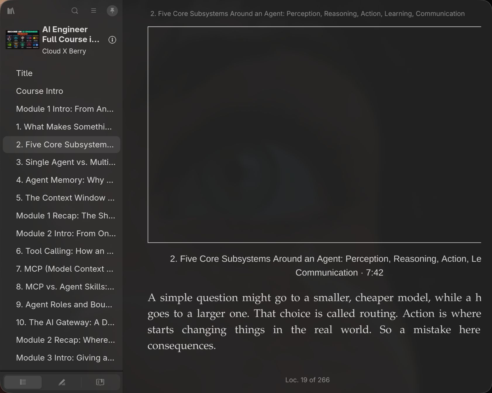

# youtube-epub

Turn a YouTube lecture into an illustrated EPUB: cleaned captions, whole sentences, unique slides, optional Vietnamese, optional Kindle AZW3.

[Tiếng Việt](README.vi.md)

## What you get

- One EPUB in the video’s language (usually English)
- Optional second EPUB in Vietnamese (`--vi`)
- Optional `.azw3` copies on a USB-connected Kindle (`--kindle`)

Each chapter follows YouTube chapter timestamps. Sentences are not split across chapters. Slides sit next to the words spoken at that time.

Best source material: slide-based courses and talks with auto-captions or manual subtitles. Talking-head-only videos still get a transcript, but few useful stills.

## Example output

English EPUB from [AI Engineer Full Course in 3 Hours](https://www.youtube.com/watch?v=XFNggsFFZJw) (~3 h, 46 chapters, 832 slides):

<p align="center">
  
</p>
<p align="center"><em>Cover taken from the video thumbnail.</em></p>

<p align="center">
  
</p>
<p align="center"><em>The book in Foliate: English table of contents and transcript next to slides.</em></p>

<p align="center">
  
  
  
</p>
<p align="center"><em>Unique slides pulled from the video (not a single frame per chapter).</em></p>

## How it works

1. **Download** with `yt-dlp`: metadata, thumbnail, captions (json3), 720p video for frames.
2. **Sentences** from auto-captions. Cues are joined, split on real sentence boundaries, then assigned to a chapter by the sentence midpoint so a line is never cut in half at a chapter edge.
3. **Slides** at 1 frame per second. A slide is kept when the frame changes enough (luma + dHash). Tween/fade runs keep only the last frame.
4. **EPUB** with cover, TOC, chapter XHTML, and JPEG slides interleaved by timestamp.
5. **Vietnamese** (optional): `agy` + `gemini-3.8-flash-low`, batched, cached in the workdir.
6. **Kindle** (optional): Calibre `ebook-convert` → AZW3 → `documents/` on the mounted Kindle. Raw `.epub` files copied over USB do not show up in the Kindle library on many devices (including Paperwhite with firmware 5.18).

## Requirements

| Tool | Role | Notes |
|------|------|--------|
| Python 3.11+ | CLI | `ebooklib`, `Pillow` (see `scripts/requirements.txt`) |
| [yt-dlp](https://github.com/yt-dlp/yt-dlp) | Video + captions | Keep it updated; YouTube extractors change |
| [ffmpeg](https://ffmpeg.org/) | 1 fps thumbs + full-res slides | |
| [agy](https://antigravity.google/) CLI | Vietnamese only | Model `gemini-3.8-flash-low` |
| [Calibre](https://calibre-ebook.com/) | Kindle only | Provides `ebook-convert` |
| Foliate (optional) | Desktop reader | `foliate book.epub` |

Install Python deps:

```bash
uv venv .venv
uv pip install -r scripts/requirements.txt --python .venv/bin/python
# or: pip install -r scripts/requirements.txt
```

Arch / Omarchy:

```bash
sudo pacman -S --needed yt-dlp ffmpeg python-pillow calibre
# ebooklib is not always packaged; use the venv above
```

Debian / Ubuntu:

```bash
sudo apt install ffmpeg python3-pip python3-venv calibre
pipx install yt-dlp   # or: pip install --user yt-dlp
```

Confirm:

```bash
command -v yt-dlp ffmpeg
python3 -c "import ebooklib, PIL; print('ok')"
```

## Install as an agent skill

The repo root is a standard `SKILL.md` skill. Install it once, then point each agent at the same folder (clone or symlink). Restart **Codex** after install — it only loads `~/.codex/skills` at session start. Grok and Claude Code pick up new skill folders without a full reinstall; open a new chat if the skill is missing from the list.

### Quick install (Claude Code + Codex + others)

[`skills`](https://skills.sh) copies the skill into `~/.agents/skills` and links the agents you name:

```bash
npx --yes skills add tungnguyentu/youtube-epub \
  --skill youtube-epub \
  -g -y \
  --agent claude-code Codex
```

Add `Grok` (display name **Grok Build**) if you also want the Grok CLI linked that way. `-a '*'` links every agent the CLI knows.

Check:

```bash
npx --yes skills ls -g -s youtube-epub
ls -ld ~/.claude/skills/youtube-epub ~/.codex/skills/youtube-epub ~/.agents/skills/youtube-epub
```

### Manual install

Clone once, then symlink into each runtime:

```bash
git clone https://github.com/tungnguyentu/youtube-epub.git ~/src/youtube-epub

mkdir -p ~/.claude/skills ~/.codex/skills ~/.grok/skills ~/.agents/skills
ln -sfn ~/src/youtube-epub ~/.claude/skills/youtube-epub
ln -sfn ~/src/youtube-epub ~/.codex/skills/youtube-epub
ln -sfn ~/src/youtube-epub ~/.grok/skills/youtube-epub
ln -sfn ~/src/youtube-epub ~/.agents/skills/youtube-epub
```

| Runtime | User skill directory | Project skill directory |
|---------|----------------------|-------------------------|
| [Claude Code](https://code.claude.com/docs/en/skills) | `~/.claude/skills/youtube-epub/` | `<repo>/.claude/skills/youtube-epub/` |
| [Codex CLI](https://github.com/openai/codex) | `~/.codex/skills/youtube-epub/` | `<repo>/.codex/skills/youtube-epub/` |
| Grok | `~/.grok/skills/youtube-epub/` | — |
| Shared (skills CLI) | `~/.agents/skills/youtube-epub/` | `<repo>/.agents/skills/youtube-epub/` |

Each directory must contain `SKILL.md` at its root (the clone already does). Do not nest an extra `youtube-epub/` inside the skill folder.

Project-only (this repo, not global):

```bash
cd /path/to/your-project
mkdir -p .claude/skills .codex/skills
ln -sfn /path/to/youtube-epub .claude/skills/youtube-epub
ln -sfn /path/to/youtube-epub .codex/skills/youtube-epub
```

### Invoke

After the skill is on disk:

**Claude Code** — new session. Paste a YouTube URL and ask for an EPUB with images, or type `/youtube-epub`. Claude matches the skill `description` and should run `scripts/youtube_epub.py` instead of reinventing the pipeline. Confirm it is listed with `/skills` (or the skills panel).

**Codex** — **quit and start a new Codex session** so `~/.codex/skills` is rescanned. Then:

```text
Turn this into an illustrated EPUB: https://youtu.be/VIDEO_ID
```

Codex does not need a slash command. If the skill does not fire, say `use the youtube-epub skill` and give the URL.

**Grok** — `/youtube-epub` or the same natural-language request. Skills auto-reload when files change.

All three should shell out to:

```bash
python3 /path/to/youtube-epub/scripts/youtube_epub.py "URL" --out ~/Work/artifacts
```

Add `--vi` / `--kindle` when you asked for Vietnamese or Kindle. Install CLI dependencies from [Requirements](#requirements) on the machine that runs the agent.

## CLI usage

Always run the script with a Python that has `ebooklib` and `Pillow`.

```bash
python3 scripts/youtube_epub.py "https://youtu.be/VIDEO_ID" \
  --out ~/Work/artifacts
```

An 11-character video id is accepted in place of a full URL.

### Flags

| Flag | Default | Meaning |
|------|---------|---------|
| `url` | required | YouTube URL or 11-char id |
| `--out DIR` | `~/Work/artifacts` if that folder exists, else current directory | Where `.epub` / `.azw3` are written |
| `--workdir DIR` | `/tmp/yt-epub-<id>` | Cache for video, thumbs, slides, translation |
| `--vi` | off | Also build a Vietnamese EPUB via `agy` |
| `--kindle` | off | Convert each produced EPUB to AZW3 and copy onto a mounted Kindle |

Reuse `--workdir` on reruns. Thumbs and slides are skipped when they already exist, and Vietnamese translation resumes from `vi_cache.json`.

### Examples

English EPUB only:

```bash
python3 scripts/youtube_epub.py "https://www.youtube.com/watch?v=XFNggsFFZJw" \
  --out ~/Work/artifacts
```

English + Vietnamese:

```bash
python3 scripts/youtube_epub.py "https://youtu.be/XFNggsFFZJw" \
  --out ~/Work/artifacts \
  --vi
```

Build both books and sideload to Kindle:

```bash
# Plug in the Kindle and wait until it mounts (usually /run/media/$USER/Kindle)
python3 scripts/youtube_epub.py XFNggsFFZJw --out ~/Work/artifacts --vi --kindle
```

Resume a long Vietnamese translation after a network drop (same workdir, cache kept):

```bash
python3 scripts/youtube_epub.py XFNggsFFZJw \
  --workdir /tmp/yt-epub-XFNggsFFZJw \
  --out ~/Work/artifacts \
  --vi
```

### Output files

For a video titled “AI Engineer Full Course in 3 Hours”:

```text
~/Work/artifacts/AI-Engineer-Full-Course-in-3-Hours.epub
~/Work/artifacts/AI-Engineer-Full-Course-in-3-Hours-vi.epub
```

Workdir (scratch, safe to delete after you have the EPUB):

```text
/tmp/yt-epub-<id>/
  video.mp4
  meta.info.json
  meta.<lang>.json3      # captions
  meta.jpg               # cover
  thumbs/                # 1 fps, 480px, detection only
  slides/                # unique full-res JPEGs
  vi_cache.json          # translation resume cache
```

Open on Linux:

```bash
foliate ~/Work/artifacts/AI-Engineer-Full-Course-in-3-Hours.epub
```

Calibre, Apple Books, and most e-readers open EPUB as well.

## Using it through an agent

Ask in plain language. `SKILL.md` tells the agent to run the CLI rather than reimplement the pipeline.

Examples:

- “Turn this into an EPUB with images: https://youtu.be/…”
- “Same video, Vietnamese EPUB too”
- “Copy both books to the Kindle that’s plugged in”

The agent should not ask extra questions when you only want the default English EPUB.

| Client | How to trigger |
|--------|----------------|
| Claude Code | `/youtube-epub` or a YouTube URL + “EPUB with images”. New chat if the skill is not in `/skills`. |
| Codex CLI | New session after install, then the same request in English or Vietnamese. |
| Grok | `/youtube-epub` or the same request. |

## Vietnamese translation

`--vi` calls the `agy` CLI (`gemini-3.8-flash-low`) with a JSON schema so line counts stay aligned.

- Voice: technical textbook, addressing the reader as *bạn*
- English kept for terms such as agent, RAG, MCP, LoRA, CUDA, GPU, context window, token
- Batches of 28 sentences; a failed batch is split and retried
- Progress is saved to `<workdir>/vi_cache.json`

A three-hour course is on the order of 80 batches (~15–25 minutes), depending on `agy` latency.

`agy` must be on `PATH` (often `~/.local/bin/agy`).

## Kindle sideload

Many Kindles ignore USB-copied `.epub`. This tool always writes `.azw3` via Calibre (`--output-profile kindle_pw3`) and copies into:

```text
/run/media/$USER/Kindle/documents/
```

It also deletes a same-named `.epub` in that folder so the library is not confused.

After copy:

1. `sync` (the script already runs this)
2. Eject the Kindle (Nautilus **Eject**, or `gio mount -u file:///run/media/$USER/Kindle`)
3. Unplug. The device indexes on disconnect. Restart the Kindle if a title is missing.

If unmount fails with “target is busy”, close the file manager window that is looking at the Kindle, then eject.

## Quality checks

After a build, confirm:

- The EPUB unzips; `dc:language` is `en` or `vi`
- The first paragraph of each chapter starts with a complete sentence (capital letter), not a leftover clause from the previous chapter
- A slide-heavy lecture produces on the order of hundreds of images, not 1–3 per chapter
- For Kindle: `.azw3` files are present under `documents/` before you eject

## Limits

- Captions are YouTube auto-captions unless the video has manual subs. Punctuation can be wrong; the tool does not rewrite the lecture.
- Slides shorter than about one second, or tiny text-only bullet adds that barely change the frame, can be missed.
- Videos with a large talking-head overlay will keep those frames as “slides”.
- `--kindle` expects the volume label `Kindle` mounted at `/run/media/$USER/Kindle`.
- `--vi` sends caption text to Google via `agy`. Do not use it on private transcripts you cannot send off-machine.

## Troubleshooting

| Symptom | What to do |
|---------|------------|
| `no captions (manual or auto)` | The video has no timed text. Cannot build a transcript EPUB. |
| `yt-dlp` extractor error | Update yt-dlp, retry. |
| Few slides / 1–3 per chapter | Confirm `ffmpeg` produced `<workdir>/thumbs` (about 1 JPEG per second of video). |
| Vietnamese batch errors | Rerun with the same `--workdir`; cache skips finished sentences. Check `agy` login/quota. |
| Kindle library empty after copy | You copied EPUB. Use `--kindle` (AZW3), eject, unplug. |
| `Kindle not mounted` | Unlock the Kindle, set USB to file transfer, wait for `/run/media/$USER/Kindle`. |
| `ebook-convert not found` | Install Calibre so `ebook-convert` is on `PATH`. |
| Foliate crash on open | Open from the app menu and pick the file; a second instance while another book is closing can glitch. |
| Codex never uses the skill | Confirm `~/.codex/skills/youtube-epub/SKILL.md` exists, then **start a new Codex session**. |

## License

Use and modify freely for personal workflows. YouTube’s terms still apply to downloaded media: keep the files private unless you own the video or have permission.
