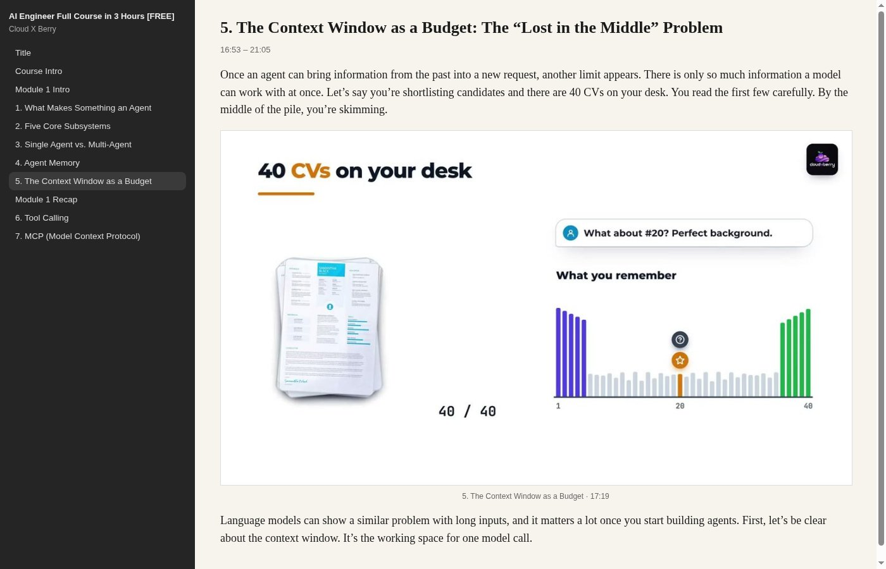
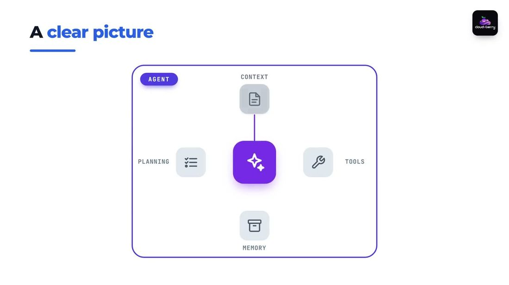
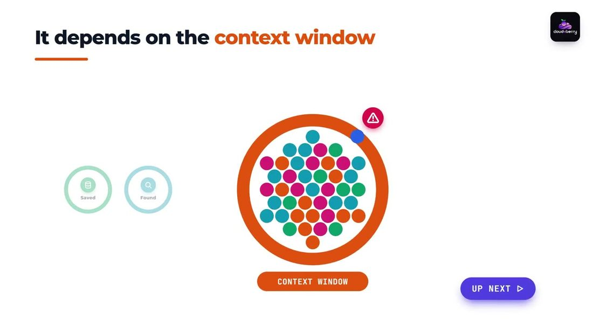
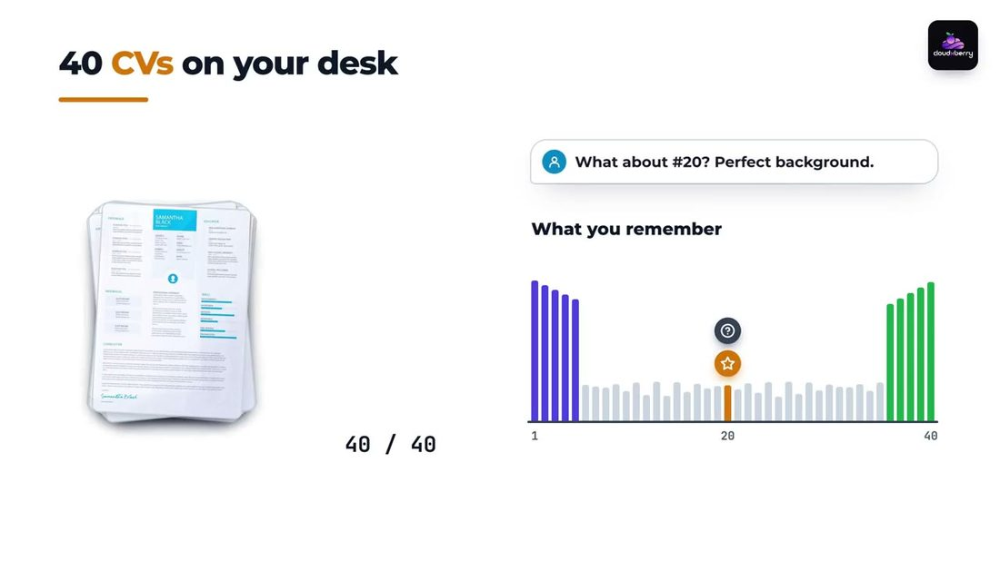

# youtube-epub

Chuyển video YouTube (khóa học, talk có slide) thành EPUB có hình: phụ đề đã làm sạch, câu không bị cắt, slide độc nhất, tùy chọn tiếng Việt và Kindle AZW3.

[English](README.md)

## Kết quả

- Một EPUB đúng ngôn ngữ gốc của video (thường là tiếng Anh)
- EPUB tiếng Việt tùy chọn (`--vi`)
- Bản `.azw3` trên Kindle gắn USB tùy chọn (`--kindle`)

Chương theo timestamp YouTube. Mỗi câu nằm trọn trong một chương. Slide đứng cạnh đoạn lời nói đúng thời điểm.

Hợp nhất với khóa học/bài giảng có slide và phụ đề (tự động hoặc thủ công). Video chỉ talking-head vẫn ra transcript, nhưng ít ảnh hữu ích.

## Ảnh mẫu (bản tiếng Anh)

EPUB tiếng Anh từ [AI Engineer Full Course in 3 Hours](https://www.youtube.com/watch?v=XFNggsFFZJw) (~3 giờ, 46 chương, 832 slide):

<p align="center">
  
</p>
<p align="center"><em>Bìa lấy từ thumbnail video.</em></p>

<p align="center">
  
</p>
<p align="center"><em>Một chương EPUB tiếng Anh: mục lục, transcript và slide cắt từ video.</em></p>

<p align="center">
  
  
  
</p>
<p align="center"><em>Slide độc nhất cắt từ video (không phải một khung đại diện mỗi chương).</em></p>

## Pipeline

1. **Tải** bằng `yt-dlp`: metadata, thumbnail, phụ đề json3, video 720p để cắt khung.
2. **Câu**: ghép cue phụ đề, tách theo dấu câu thật, gán chương theo mốc giữa câu — không cắt câu ở ranh chương.
3. **Slide**: 1 khung/giây. Giữ khung khi ảnh đổi đủ lớn (luma + dHash). Chuỗi tween/fade chỉ giữ khung cuối.
4. **EPUB**: bìa, mục lục, XHTML từng chương, JPEG xen theo timestamp.
5. **Tiếng Việt** (tùy chọn): `agy` + `gemini-3.8-flash-low`, theo lô, cache trong workdir.
6. **Kindle** (tùy chọn): Calibre `ebook-convert` → AZW3 → thư mục `documents/` trên Kindle đã mount. File `.epub` copy USB thường **không hiện** trong thư viện Kindle (kể cả Paperwhite firmware 5.18).

## Yêu cầu

| Công cụ | Việc | Ghi chú |
|---------|------|---------|
| Python 3.11+ | CLI | `ebooklib`, `Pillow` (`scripts/requirements.txt`) |
| [yt-dlp](https://github.com/yt-dlp/yt-dlp) | Video + phụ đề | Nên cập nhật thường xuyên |
| [ffmpeg](https://ffmpeg.org/) | Thumb 1 fps + slide đủ nét | |
| CLI [agy](https://antigravity.google/) | Chỉ khi dịch Việt | Model `gemini-3.8-flash-low` |
| [Calibre](https://calibre-ebook.com/) | Chỉ khi đưa Kindle | Lệnh `ebook-convert` |
| Foliate (không bắt buộc) | Đọc trên desktop | `foliate sach.epub` |

Cài thư viện Python:

```bash
uv venv .venv
uv pip install -r scripts/requirements.txt --python .venv/bin/python
# hoặc: pip install -r scripts/requirements.txt
```

Arch / Omarchy:

```bash
sudo pacman -S --needed yt-dlp ffmpeg python-pillow calibre
# ebooklib thường không có sẵn trong pacman; dùng venv ở trên
```

Debian / Ubuntu:

```bash
sudo apt install ffmpeg python3-pip python3-venv calibre
pipx install yt-dlp
```

Kiểm tra:

```bash
command -v yt-dlp ffmpeg
python3 -c "import ebooklib, PIL; print('ok')"
```

## Cài thành skill agent (Claude, Codex, Grok)

Repo có `SKILL.md` ở thư mục gốc. Cài một lần, rồi trỏ từng agent vào cùng folder (clone hoặc symlink). **Codex phải mở session mới** — nó chỉ đọc `~/.codex/skills` lúc khởi động. Grok và Claude Code nạp folder skill mới nhanh hơn; nếu chưa thấy skill thì mở chat mới.

### Cài nhanh (Claude Code + Codex)

[`skills`](https://skills.sh) copy skill vào `~/.agents/skills` và link các agent bạn chỉ định:

```bash
npx --yes skills add tungnguyentu/youtube-epub \
  --skill youtube-epub \
  -g -y \
  --agent claude-code Codex
```

Thêm `Grok` (tên hiển thị **Grok Build**) nếu muốn link Grok CLI. `-a '*'` link mọi agent mà CLI biết.

Kiểm tra:

```bash
npx --yes skills ls -g -s youtube-epub
ls -ld ~/.claude/skills/youtube-epub ~/.codex/skills/youtube-epub ~/.agents/skills/youtube-epub
```

### Cài tay

Clone một chỗ, symlink vào từng runtime:

```bash
git clone https://github.com/tungnguyentu/youtube-epub.git ~/src/youtube-epub

mkdir -p ~/.claude/skills ~/.codex/skills ~/.grok/skills ~/.agents/skills
ln -sfn ~/src/youtube-epub ~/.claude/skills/youtube-epub
ln -sfn ~/src/youtube-epub ~/.codex/skills/youtube-epub
ln -sfn ~/src/youtube-epub ~/.grok/skills/youtube-epub
ln -sfn ~/src/youtube-epub ~/.agents/skills/youtube-epub
```

| Runtime | Skill user | Skill theo project |
|---------|------------|-------------------|
| [Claude Code](https://code.claude.com/docs/en/skills) | `~/.claude/skills/youtube-epub/` | `<repo>/.claude/skills/youtube-epub/` |
| [Codex CLI](https://github.com/openai/codex) | `~/.codex/skills/youtube-epub/` | `<repo>/.codex/skills/youtube-epub/` |
| Grok | `~/.grok/skills/youtube-epub/` | — |
| Dùng chung (skills CLI) | `~/.agents/skills/youtube-epub/` | `<repo>/.agents/skills/youtube-epub/` |

Mỗi thư mục phải có `SKILL.md` ngay gốc (clone đã đúng). Đừng lồng thêm một tầng `youtube-epub/` bên trong.

Chỉ gắn vào một project:

```bash
cd /path/to/your-project
mkdir -p .claude/skills .codex/skills
ln -sfn /path/to/youtube-epub .claude/skills/youtube-epub
ln -sfn /path/to/youtube-epub .codex/skills/youtube-epub
```

### Gọi skill

**Claude Code** — session mới. Dán URL YouTube và xin EPUB có hình, hoặc gõ `/youtube-epub`. Claude khớp field `description` rồi chạy `scripts/youtube_epub.py`, không tự viết lại pipeline. Xem skill đã có chưa bằng `/skills`.

**Codex** — **tắt hẳn rồi mở Codex session mới** để quét `~/.codex/skills`. Sau đó:

```text
Chuyển video này thành EPUB có hình: https://youtu.be/VIDEO_ID
```

Codex không cần slash command. Nếu không tự bật skill, nói `dùng skill youtube-epub` và gửi URL.

**Grok** — `/youtube-epub` hoặc cùng một câu tiếng thường. Skill tự reload khi file đổi.

Cả ba nên gọi:

```bash
python3 /path/to/youtube-epub/scripts/youtube_epub.py "URL" --out ~/Work/artifacts
```

Thêm `--vi` / `--kindle` khi bạn xin bản Việt hoặc đưa Kindle. Máy chạy agent vẫn cần đủ [Yêu cầu](#yêu-cầu).

## Dùng CLI

Chạy script bằng Python đã cài `ebooklib` và `Pillow`.

```bash
python3 scripts/youtube_epub.py "https://youtu.be/VIDEO_ID" \
  --out ~/Work/artifacts
```

Có thể truyền id 11 ký tự thay vì URL đầy đủ.

### Cờ

| Cờ | Mặc định | Ý nghĩa |
|----|----------|---------|
| `url` | bắt buộc | URL YouTube hoặc id 11 ký tự |
| `--out DIR` | `~/Work/artifacts` nếu thư mục đó tồn tại, không thì thư mục hiện tại | Nơi ghi `.epub` / `.azw3` |
| `--workdir DIR` | `/tmp/yt-epub-<id>` | Cache video, thumb, slide, bản dịch |
| `--vi` | tắt | Thêm EPUB tiếng Việt qua `agy` |
| `--kindle` | tắt | Đổi AZW3 và copy vào Kindle đang mount |

Dùng lại `--workdir` khi chạy lần hai. Thumb/slide đã có thì bỏ qua; dịch Việt tiếp từ `vi_cache.json`.

### Ví dụ

Chỉ EPUB tiếng Anh:

```bash
python3 scripts/youtube_epub.py "https://www.youtube.com/watch?v=XFNggsFFZJw" \
  --out ~/Work/artifacts
```

Anh + Việt:

```bash
python3 scripts/youtube_epub.py "https://youtu.be/XFNggsFFZJw" \
  --out ~/Work/artifacts \
  --vi
```

Làm hai sách rồi đưa vào Kindle:

```bash
# Cắm Kindle, đợi mount (thường /run/media/$USER/Kindle)
python3 scripts/youtube_epub.py XFNggsFFZJw --out ~/Work/artifacts --vi --kindle
```

Tiếp bản dịch Việt sau khi mạng đứt (cùng workdir, giữ cache):

```bash
python3 scripts/youtube_epub.py XFNggsFFZJw \
  --workdir /tmp/yt-epub-XFNggsFFZJw \
  --out ~/Work/artifacts \
  --vi
```

### File đầu ra

Với video “AI Engineer Full Course in 3 Hours”:

```text
~/Work/artifacts/AI-Engineer-Full-Course-in-3-Hours.epub
~/Work/artifacts/AI-Engineer-Full-Course-in-3-Hours-vi.epub
```

Workdir (xóa được sau khi đã có EPUB):

```text
/tmp/yt-epub-<id>/
  video.mp4
  meta.info.json
  meta.<lang>.json3      # phụ đề
  meta.jpg               # bìa
  thumbs/                # 1 fps, 480px, chỉ để phát hiện đổi cảnh
  slides/                # JPEG slide đủ nét
  vi_cache.json          # cache dịch, để chạy lại
```

Mở trên Linux:

```bash
foliate ~/Work/artifacts/AI-Engineer-Full-Course-in-3-Hours.epub
```

Calibre, Apple Books và hầu hết máy đọc sách đều mở được EPUB.

## Dùng qua agent

Nói tiếng thường. `SKILL.md` bảo agent gọi CLI, không viết lại pipeline.

Ví dụ:

- “Chuyển video này thành EPUB có hình: https://youtu.be/…”
- “Cùng video, thêm bản tiếng Việt”
- “Copy hai sách vào Kindle đang cắm”

Khi bạn chỉ cần EPUB tiếng Anh mặc định, agent không cần hỏi thêm.

| Client | Cách bật |
|--------|----------|
| Claude Code | `/youtube-epub` hoặc URL YouTube + “EPUB có hình”. Chat mới nếu `/skills` chưa có. |
| Codex CLI | Session mới sau khi cài, rồi cùng một yêu cầu. |
| Grok | `/youtube-epub` hoặc cùng yêu cầu. |

## Dịch tiếng Việt

`--vi` gọi CLI `agy` (`gemini-3.8-flash-low`) với JSON schema để số câu khớp.

- Giọng giáo trình kỹ thuật, xưng hô *bạn*
- Giữ tiếng Anh với thuật ngữ: agent, RAG, MCP, LoRA, CUDA, GPU, context window, token
- Mỗi lô 28 câu; lô lỗi thì tách đôi rồi thử lại
- Lưu tiến độ tại `<workdir>/vi_cache.json`

Khóa ~3 giờ khoảng 80 lô (15–25 phút), tùy `agy`.

`agy` phải có trên `PATH` (thường `~/.local/bin/agy`).

## Đưa lên Kindle

Nhiều Kindle bỏ qua `.epub` copy USB. Tool luôn xuất `.azw3` bằng Calibre (`--output-profile kindle_pw3`) rồi copy vào:

```text
/run/media/$USER/Kindle/documents/
```

Đồng thời xóa file `.epub` cùng tên trong thư mục đó.

Sau khi copy:

1. `sync` (script đã gọi)
2. Eject Kindle (Nautilus **Eject**, hoặc `gio mount -u file:///run/media/$USER/Kindle`)
3. Rút cáp. Máy index khi ngắt kết nối. Restart Kindle nếu chưa thấy sách.

Nếu unmount báo “target is busy”: đóng cửa sổ trình quản lý file đang mở Kindle, rồi eject lại.

## Kiểm tra chất lượng

Sau khi build, xem:

- EPUB giải nén được; `dc:language` là `en` hoặc `vi`
- Đoạn đầu mỗi chương là câu đủ (chữ hoa), không phải mẩu câu dở từ chương trước
- Bài giảng nhiều slide cho ra cỡ hàng trăm ảnh, không phải 1–3 ảnh/chương
- Kindle: đã có `.azw3` trong `documents/` trước khi eject

## Giới hạn

- Phụ đề mặc định là auto-caption YouTube (trừ khi video có sub thủ công). Dấu câu có thể sai; tool không viết lại bài giảng.
- Slide hiện dưới ~1 giây, hoặc bullet đổi rất ít trên khung hình, có thể bị bỏ.
- Video talking-head chiếm phần lớn khung sẽ bị lấy luôn những khung đó làm “slide”.
- `--kindle` cần volume tên `Kindle` mount tại `/run/media/$USER/Kindle`.
- `--vi` gửi nội dung phụ đề ra Google qua `agy`. Đừng dùng với transcript không được phép rời máy.

## Xử lý lỗi

| Hiện tượng | Cách xử lý |
|------------|------------|
| `no captions (manual or auto)` | Video không có phụ đề theo thời gian. Không làm EPUB transcript được. |
| Lỗi extractor `yt-dlp` | Cập nhật yt-dlp, chạy lại. |
| Rất ít slide / 1–3 ảnh mỗi chương | Kiểm tra `<workdir>/thumbs` (cỡ 1 JPEG mỗi giây video). |
| Lỗi lô dịch Việt | Chạy lại cùng `--workdir`; cache bỏ qua câu đã xong. Kiểm tra đăng nhập/quota `agy`. |
| Kindle không thấy sách | Đã copy EPUB. Dùng `--kindle` (AZW3), eject, rút cáp. |
| `Kindle not mounted` | Mở khóa Kindle, USB file transfer, đợi `/run/media/$USER/Kindle`. |
| `ebook-convert not found` | Cài Calibre để có `ebook-convert` trên `PATH`. |
| Foliate crash khi mở | Mở từ menu ứng dụng rồi chọn file; hai cửa sổ chồng lúc đóng sách cũ dễ lỗi. |
| Codex không dùng skill | Kiểm tra `~/.codex/skills/youtube-epub/SKILL.md`, rồi **mở Codex session mới**. |

## Giấy phép

Dùng và sửa tự do cho việc cá nhân. Điều khoản YouTube vẫn áp dụng với media đã tải: giữ file riêng trừ khi bạn sở hữu video hoặc có quyền phân phối.
